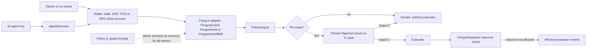

<div align="center">

# Fengce

### The wallet-level enforcement layer for TapeOut.

Your rules run as TapeOut circuits on X Layer, and the wallet itself enforces them, for owners and AI agents alike.

<a id="demo-video"></a>**Demo video:** DEMO_VIDEO_LINK

**X Layer Mainnet · Chain ID 196 · v2 live**

[Live app](https://getfengce.vercel.app) · [On TapeOut DeWeb: 6.2.180.tape](https://6-2-180.tapekit.org/) · [Try it](docs/TRY-IT.md) · [Demo video](#demo-video) · [Docs](docs/INTEGRATION.md) · [SDK on npm](https://www.npmjs.com/package/@fengce/sdk) · [Sourcify](https://repo.sourcify.dev/196/0x9D2A482fFA86fa3193F85c451A44576E2f1C8E6e)
<!-- demo video: replace DEMO_VIDEO_LINK above (and #demo-video in the link row) with the video URL -->

</div>

### Judges start here (60 seconds)

1. Open the live site: [getfengce.vercel.app](https://getfengce.vercel.app). Everything is read from X Layer by your browser.
2. See the wallet decide on mainnet: an agent's 1.5 USDT0 transfer **DENIED**
   ([0x9b70…4a1b](https://www.oklink.com/x-layer/tx/0x9b70d386a2782e269ab1d3b1df6de767534a5b5b7904998abd92a651d2584a1b)),
   then 0.5 USDT0 **ALLOWED** ([0x7a70…ccab](https://www.oklink.com/x-layer/tx/0x7a70f5c9713fd9236ecdd81287bcf775253d2cbea19c857524bb1047acfcccab)).
3. Open the Verdict demo market: [market #0](https://getfengce.vercel.app/verdict/?id=0) on
   [`0xb258…7c55`](https://www.oklink.com/x-layer/address/0xb2589D3153411c5dcedFA83692AcaAC3d93A7c55); once it is checkpointed
   (after the deadline), its Re-run panel re-checks the settlement in your browser.
4. The same app, stored on X Layer and checked file by file: [6.2.180.tape](https://6-2-180.tapekit.org/).
5. Install it on your own Safe in a few minutes: [docs/TRY-IT.md](docs/TRY-IT.md). The full write-up:
   [docs/SUBMISSION.md](docs/SUBMISSION.md).

Fengce is a wallet enforcement layer, not a new wallet, an agent framework, or an off-chain monitor.

| | Session keys & role modules (Zodiac Roles, Smart Sessions) | Off-chain policy engines | Pre-sign checkers | Fengce |
|---|---|---|---|---|
| Binds owners too | No: they scope delegated keys and modules; owners act directly | Only keys held by the provider | No: advisory | [yes](docs/CLAIMS.md#binds-owners) |
| Enforced by the wallet at execution | Yes | No: enforced when signing, off chain | No | [yes](docs/CLAIMS.md#enforced-at-execution) |
| Policy can't be swapped quietly | No: the account changes roles or sessions at once, unless a separate delay module is added | No: changed by the provider's admins, not visible on chain | n/a | [yes](docs/CLAIMS.md#no-quiet-swap) |
| Other contracts can verify it | No standard check | No | No | [yes](docs/CLAIMS.md#verifiable) |
| Rule is a TapeOut circuit | No | No | No | [yes](docs/CLAIMS.md#tapeout-circuit) |

## Why Fengce

Each of these passed a check that only looked, or only asked.

| Incident | Loss | What happened | Why the check failed | With Fengce | Evidence |
|---|---|---|---|---|---|
| **Binance** (Oct 2026) | ~$6.3B | Attacker took over the internal signing service and drained hot wallets. | Every withdrawal carried a valid signature, so nothing looked wrong. | Plain key wallets can't be restricted on-chain. As Fengce-guarded smart wallets, a per-hour outflow rule would have capped the loss, and the limit couldn't be raised in the same 20 minutes. | [budgets](docs/CLAIMS.md#budgets), [no-quiet-swap](docs/CLAIMS.md#no-quiet-swap) |
| **Bybit** (Feb 2025) | ~$1.5B | The Safe screen showed a normal transfer while signers approved a contract upgrade. | Signers trusted what the interface showed them. | FengceGuard refuses that kind of call outright; wallet setup changes wait days, in public. | [delegatecall-blocked](docs/CLAIMS.md#delegatecall-blocked), [no-quiet-swap](docs/CLAIMS.md#no-quiet-swap) |
| **Freysa** (Nov 2024) | $47K | A player talked an AI agent out of its "never send funds" rule. | The only rule lived in the agent's prompt. | The circuit doesn't read prompts. | [no-prompt-input](docs/CLAIMS.md#no-prompt-input) |
| **AIXBT** (Mar 2025) | ~$106K | Attacker got into the agent's dashboard and queued transfers. | Whoever controls the dashboard controls the agent. | Over-limit transfers revert, and the rule can't be changed for days. | [agent-executor](docs/CLAIMS.md#agent-executor), [no-quiet-swap](docs/CLAIMS.md#no-quiet-swap) |

Sources: [Binance](https://socradar.io/blog/binance-hack-6-3b-hot-wallet-theft/), [Bybit](https://blocksec.com/blog/bybit-incident-a-web2-breach-enables-the-largest-crypto-hack-in-history), [Freysa](https://www.theblock.co/post/328747/human-player-outwits-freysa-ai-agent-in-47000-crypto-challenge), [AIXBT](https://www.theblock.co/post/346911/ai-crypto-bot-aixbt-lost-eth-hack-unauthorized-dashboard-access). Losses and dates are as reported there.

**When an AI agent goes wrong**

| | Prompt rules (agent instructions) | Pocket Universe, Wallet Guard, Rabby, Blockaid | Coinbase CDP, Privy, Turnkey | Fengce |
|---|---|---|---|---|
| Agent talked out of its rule (Freysa) | Bypassed | No human to read the warning; it signs | Blocked if the policy was set | Blocked: the circuit doesn't read prompts ([no-prompt-input](docs/CLAIMS.md#no-prompt-input)) |
| Agent's dashboard hijacked (AIXBT) | Bypassed | Not involved | Blocked unless the attacker also reaches the policy admin | Blocked, and the rule can't change for days ([agent-executor](docs/CLAIMS.md#agent-executor), [no-quiet-swap](docs/CLAIMS.md#no-quiet-swap)) |
| Rogue co-owner or stolen owner key | n/a | Warning, clicked through | Owner can change the policy | Blocked: owners are bound too ([binds-owners](docs/CLAIMS.md#binds-owners)) |
| Vendor's servers down or compromised | n/a | n/a | Exposed | Not affected: no vendor in the loop ([enforced-at-execution](docs/CLAIMS.md#enforced-at-execution)) |

**Where Fengce is different**

| | Coinbase CDP, Privy, Turnkey | Hypernative Guardian (Safe Shield) | MetaMask Delegation Toolkit, Zodiac Roles | Fengce |
|---|---|---|---|---|
| Who runs the check | The vendor's enclave | Hypernative's service plus a Safe guard | On-chain contract | On-chain, a public TapeOut circuit ([tapeout-circuit](docs/CLAIMS.md#tapeout-circuit)) |
| Company in the middle | Yes | Yes | No | No ([enforced-at-execution](docs/CLAIMS.md#enforced-at-execution)) |
| Binds the owners too | Owners control the policy | Policy-dependent | No, delegates only | Yes ([binds-owners](docs/CLAIMS.md#binds-owners)) |
| Can the rule change quietly | Yes, instantly through the API | Through their dashboard | Owner can change it | No: changes wait days, in public ([no-quiet-swap](docs/CLAIMS.md#no-quiet-swap)) |
| Other contracts can check it | No | No | No | Yes, isBound ([verifiable](docs/CLAIMS.md#verifiable)) |
| Works on the wallet you already have | No, their wallet | Safe only | Their account types | Safe, Kernel, Alchemy and others ([wallet-types-8](docs/CLAIMS.md#wallet-types-8)) |
| Rule format | Their JSON rules | Their policies | Fixed caveat types | Any TapeOut circuit ([tapeout-circuit](docs/CLAIMS.md#tapeout-circuit)) |
| Chains | Many | Many | Many | X Layer today ([v2 deployment](deployments/xlayer-196-v2.json)) |

The Fengce column links to the evidence for each cell. The other columns summarise each product's public documentation and are not tested here.

## The problem and the solution

**The problem.** Spending limits on smart wallets today mostly bind the keys you hand out, such as session keys,
delegated roles and AI agents, while the owners keep a direct path around them. Off-chain policy engines and pre-sign
checkers decide outside the wallet, so a transaction signed another way is not stopped. And a limit that its own holders
can switch off in one transaction protects no one from a hurried or compromised owner.

**The solution.** Fengce plugs into the wallet you already have (a Safe guard, an ERC-7579 or ERC-6900 hook, or an agent
owner) and makes the wallet itself run every transaction through a pinned TapeOut circuit on X Layer before it executes.
The rule can be an amount cap, a budget per period, allowed recipients or tokens, approval limits, trading rules or a
company-wide floor. **Owners choose a rule and set its values; circuit designers build the circuits; organisation admins
set floors that team policies cannot go below; agents can only act inside them.** Changing or removing the rule waits for
a public timelock, and removing the guard needs every owner.

## Live mainnet proof

Release v2, demo Safe [`0x0bb9…0707`](https://www.oklink.com/x-layer/address/0x0bb926DC7F79e4CEFFB30a67E8291C56C3F50707) (one owner, policy *Stablecoin Transfer Limit* with a 1 USDT0 cap, one agent through
AgentExecutor). The agent tried 1.5 USDT0 first, then 0.5:

| Agent transfer | Result | Transaction |
|---|---|---|
| 1.5 USDT0 (over the cap) | **Denied**, recorded as `Denied` with `FengceDenied(safe, USDT0)`; nothing moved | [0x9b70…4a1b](https://www.oklink.com/x-layer/tx/0x9b70d386a2782e269ab1d3b1df6de767534a5b5b7904998abd92a651d2584a1b) |
| 0.5 USDT0 (within the cap) | **Allowed**; the Safe went from 1.5 to 1.0 USDT0 | [0x7a70…ccab](https://www.oklink.com/x-layer/tx/0x7a70f5c9713fd9236ecdd81287bcf775253d2cbea19c857524bb1047acfcccab) |

Policy: [Stablecoin Transfer Limit](https://getfengce.vercel.app/policy/?processor=0x839bdD6fa7A66416A609A735e11DE5411B98574e&id=2) (pin
`0x6661c56a…`, [pin transaction](https://www.oklink.com/x-layer/tx/0x7edc0878f7bdb77f1c7b1a2fa7dec42ebec4adf68ee756d1d56e6b0ce543f7eb)). Release: [v2 addresses](deployments/xlayer-196-v2.json),
built from commit `e260a37`. The previous release ran the same demo: [0.5 allowed](https://www.oklink.com/x-layer/tx/0x6797257c0ea35fe0ec7b2d80f3bd29275a172e52286f9dbff96fc98e81f05e38), [1.5 denied](https://www.oklink.com/x-layer/tx/0xbfe43e982f563f9e3dc1a4641e259b04ace0635dfab769c59ec7532492e24760).

- **Tests:** 112 pass in [CI for e260a37](https://github.com/pgreyy/fengce/actions/runs/44346520788): 44 unit, 53 core and Safe fork tests, 15 wallet fork tests.
- **Wallet types:** 8 with a tested adapter: Safe, Safe + Safe7579, Kernel, Nexus, Etherspot, Modular Account v2, EIP-7702 and Coinbase Smart Wallet ([evidence](docs/CLAIMS.md#wallet-types-8)).
- **Sourcify:** 18/18 v2 contracts verified, exact match ([list](docs/CLAIMS.md#sourcify-18)).
- **Verdict:** prediction markets on pinned circuits, live at [`0xb258…7c55`](https://www.oklink.com/x-layer/address/0xb2589D3153411c5dcedFA83692AcaAC3d93A7c55), verified on Sourcify, one demo market ([evidence](docs/CLAIMS.md#verdict-live), [docs/VERDICT.md](docs/VERDICT.md)).
- **Every claim** in this README links to its evidence in [docs/CLAIMS.md](docs/CLAIMS.md) ([claims.json](docs/claims.json)).

## A 2 minute path (for judges)

1. Open [getfengce.vercel.app](https://getfengce.vercel.app). Everything is read from X Layer by your browser; nothing to connect.
2. **Catalog**: five listed policies with tier, gas and installs.
3. **Try it**: open *Numeric Transaction Limit* in the Catalog and its **Try it** tab, then press Run. Watch the 114-gate
   circuit evaluate level by level and end on ALLOWED or DENIED, with the facts and input bits on the left.
4. **Protect → Check a wallet**: the demo Safe's guards, timelocks and the Denied agent call.
5. Open the two transactions above on the explorer.

## How it works

1. A transaction leaves the wallet: an owner's Safe transaction, a module or agent call, or an ERC-7579 or ERC-6900 execution.
2. The wallet's Fengce adapter decodes it into facts (recipient, token, amount, kind) and encodes them as circuit input bits
   with the policy's schema.
3. PolicyEngine checks the pin (netlist, every referenced circuit, the evaluator code) and evaluates the TapeOut circuit on X
   Layer. Output bit 0 = 1 allows; anything else, including a revert or a broken pin, denies.
4. Optionally FengceInspector checks the outcome after execution (outflow, approvals and, on a Safe, its configuration).
5. Changing the policy waits for the admin timelock; removing the guard needs every owner and the recovery delay.



## What you can build

- **Treasuries**: a Safe whose owners cannot move more than the policy allows without a public, days-long change.
- **AI agents**: give an agent a key through AgentExecutor; every call it makes passes the circuit, and refusals are on record.
- **Trading desks**: swaps only through decoded routers, within caps, with proceeds back to the account.
- **Protocols**: accept deposits only from accounts bound to a policy with a notice period, through `FengceBinding.isBound` or `BoundOnly`.
- **Wallet providers**: ship the hook adapters for ERC-7579 and ERC-6900 accounts.
- **Circuit designers**: build TapeOut circuits, list them in the Catalog with test vectors that run on chain, and earn install fees.
- **Organisations with many wallets**: shared budgets per period across Safes (Tick) and floors that team policies cannot go below.

## Integration quickstarts

**Website.** On [Protect](https://getfengce.vercel.app/protect/), choose the wallet, then Install: run the preflight for a Safe (existing approvals) and
import the Safe Transaction Builder JSON. Other wallet types show the exact install calls.

**SDK** ([@fengce/sdk on npm](https://www.npmjs.com/package/@fengce/sdk), [sdk/README.md](sdk/README.md)):

```sh
npm install @fengce/sdk
```

```ts
import { preSign, buildInstall } from "@fengce/sdk";

const verdict = await preSign(client, { processor, circuitId, schema }, safe, { to, value, data }); // "allow" | "deny", before signing
const { calls } = await buildInstall(client, { safe, guard, pinId, schema, recoveryDelay: 172_800n, recoveryWindow: 172_800n, adminDelay: 86_400n });
```

```sh
npx fengce-quote <processor> <circuitId>   # gas on the full Safe path and a tier, on a local fork of X Layer
```

**Solidity** ([src/binding](src/binding)):

```solidity
import {FengceBinding} from "fengce/src/binding/FengceBinding.sol";
import {BoundOnlyBase} from "fengce/src/binding/BoundOnly.sol";

contract Vault is BoundOnlyBase {
    constructor(FengceBinding b, bytes32 policyHash) BoundOnlyBase(b, policyHash, 3 days) {}
    function deposit() external payable onlyBound { /* msg.sender is a Safe bound to policyHash, no change possible for 3 days */ }
}
```

## For AI agents

- **MCP server** ([mcp/](mcp/README.md)): `list_policies`, `get_policy`, `quote_policy`, `simulate_transaction`,
  `preflight_transaction`, `build_install_payload`. Read-only and unsigned; set up in one line for Claude Code, Claude
  Desktop or any MCP client ([proof](docs/CLAIMS.md#mcp-read-only)).
- **Preflight API**: `POST https://getfengce.vercel.app/api/preflight` checks a transaction against the policy installed on a Safe
  ([proof](docs/CLAIMS.md#preflight-own-policy), [API](docs/API.md)).
- **OnchainOS skill** ([skills/fengce](skills/fengce/SKILL.md)), in the okx/plugin-store format: check with Fengce before
  acting and treat Denied as final.
- **Demo**: an agent asks Fengce, gets DENIED for 1.5 USDT0 and ALLOWED for 0.5, then the wallet enforces both
  ([transcript](docs/demo/agent-demo-transcript.md), [proof](docs/CLAIMS.md#agent-demo-fork)).

The rule for agents: before acting for a Safe, preflight the transaction; if the answer is deny, stop and tell the user. Do
not split, reroute or retry it.

## Wallet compatibility

8 wallet types have an adapter with a passing test ([list with tests](docs/WALLETS.md#wallet-types-with-a-tested-adapter-8)); the table also lists
wallets that are untested or not integrated.

**Mainnet**: adapter on X Layer mainnet and used there in real transactions. **Fork-tested**: adapter on mainnet, behaviour
proven on a fork of live mainnet state. **Agent-only**: agents are checked, owners are not. **Partial**: pre-execution checks
work, with a known way to remove the hook or skip the timelock. **Not integrated**: no adapter.

Non-Safe hooks still check every call before it executes; what they lack is only the Safe configuration invariants (owners,
threshold, modules, guards, fallback handler) that FengceInspector can read on a Safe.

| Wallet | Status | Adapter live on mainnet | Test environment | Pre-execution check | Outcome check | Safe config invariants | Uninstall / admin protection | Agent-only | isBound | Known bypasses |
|---|---|---|---|---|---|---|---|---|---|---|
| Safe v1.5.0 | **Mainnet** | [`0x9D2A…8E6e`](https://www.oklink.com/x-layer/address/0x9D2A482fFA86fa3193F85c451A44576E2f1C8E6e) | X Layer mainnet; X Layer mainnet fork | yes | yes (FengceInspector) | yes (owners, threshold, modules, guards, fallback handler) | admin timelock (at least 1 day); guard removal only by recovery: all owners, at least 2 days | no | yes | none known |
| Safe + Safe7579 v1.0.0 | **Partial** | [`0xE538…669b`](https://www.oklink.com/x-layer/address/0xE538979145E67935B85D1912904ce8d5bF19669b) | X Layer mainnet fork with Safe7579 code from Base | yes | yes (FengceInspector, Safe-based) | yes (Safe-based) | module changes timelocked on four routes | no | no | Safe7579 does not run a hook on its own uninstall |
| ZeroDev Kernel v3.3 | **Fork-tested** | [`0xE538…669b`](https://www.oklink.com/x-layer/address/0xE538979145E67935B85D1912904ce8d5bF19669b) | X Layer mainnet fork, live Kernel v3.3 code | yes | available (setInspector), not tested on Kernel | no (code hash only) | hook uninstall waits 2 days; validator, executor, fallback installs, root validator changes and upgrades are scheduled admin actions (2 days) | no | no | installing another hook is not checked; validations installed without FengceHook do not run it |
| Biconomy Nexus 1.2.0 | **Partial** | [`0xE538…669b`](https://www.oklink.com/x-layer/address/0xE538979145E67935B85D1912904ce8d5bF19669b) | X Layer mainnet fork with Nexus code from Base | yes | available, not tested on Nexus | no (code hash only) | hook uninstall waits 2 days | no | no | emergencyUninstallHook (owner-signed, Nexus's own 1-day timelock) removes the hook without running it (from source, not tested) |
| Etherspot ModularEtherspotWallet v1.0.0 | **Partial** | [`0xE538…669b`](https://www.oklink.com/x-layer/address/0xE538979145E67935B85D1912904ce8d5bF19669b) | X Layer mainnet fork with Etherspot code from Base | yes | available, not tested on Etherspot | no (code hash only) | none: uninstallModule does not run the hook | no | no | uninstallModule removes the hook at once |
| Alchemy Modular Account v2 (ERC-6900) | **Fork-tested** | [`0xAf48…BEA5`](https://www.oklink.com/x-layer/address/0xAf481abCb80A73C9c300f16aAF1b61BcAaC3BEA5) | X Layer mainnet fork, live Modular Account v2 code | yes | yes (FengceInspector wired in the test) | no (code hash only) | uninstall and account upgrade wait 2 days | no | no | performCreate with value 0 is allowed; other installs are not delayed |
| EIP-7702 EOA (SemiModularAccount7702) | **Agent-only** | [`0xAf48…BEA5`](https://www.oklink.com/x-layer/address/0xAf481abCb80A73C9c300f16aAF1b61BcAaC3BEA5) | X Layer mainnet fork, live SemiModularAccount7702 | yes, for agents | available | no | uninstall and upgrade wait 2 days | yes | no | the EOA key can always send a plain transaction |
| Coinbase Smart Wallet v1.1 | **Agent-only** | [`0xd857…aD21`](https://www.oklink.com/x-layer/address/0xd857d1850684aC80E7DDa4ab52ea6E1B1CB0aD21) | X Layer mainnet fork with Coinbase code from Base | yes, for agents | available (setInspector) | no | none: owners can remove FengceAgentOwner at any time | yes | no | owners are not checked |
| Alchemy MultiOwnerLightAccount v2 | **Agent-only** | [`0xd857…aD21`](https://www.oklink.com/x-layer/address/0xd857d1850684aC80E7DDa4ab52ea6E1B1CB0aD21) | not tested | yes, for agents (not tested) | available | no | none | yes | no | owners are not checked |
| MetaMask EIP-7702 DeleGator | **Not integrated** | – | none | no | no | no | n/a | n/a | no | agents use delegations and caveat enforcers; Fengce has no caveat enforcer yet |
| OKX Wallet (EIP-7702) | **Not integrated** | – | none | not checked | no | no | n/a | n/a | no | not checked which contract it delegates to |
| Alchemy LightAccount v2 (single owner) | **Not integrated** | – | none | no | no | no | n/a | n/a | no | a single owner: FengceAgentOwner would replace the owner's own access |

Evidence per row: [docs/WALLETS.md](docs/WALLETS.md) ([wallets.json](docs/wallets.json)).

## Policy catalogue and gas

**Full Safe path** = Safe overhead + pre-check + outcome check. **Eval gas** = circuit evaluation only. Tiers: Green up to
1,000,000 gas on the full Safe path, Amber up to 3,500,000, Red above. Full breakdown: [docs/GAS.md](docs/GAS.md).

| Policy | What it enforces | Gates | Eval gas (Catalog) | Full Safe path | Tier (Quote) |
|---|---|---|---|---|---|
| Stablecoin Transfer Limit | a transfer passes only if its amount is at most the cap | 3 | 34,085 | 288,485 | Green |
| Numeric Transaction Limit | a value must be at or below a limit (16-bit comparator) | 114 | 293,333 | 909,463 | Green |
| Organization-Wide Policy Floor | a team policy plus an organisation's floor; both must allow | 6 | 159,800 | 524,222 | Green |
| Periodic Spending Budget | one spend per period, reset each period (stateful, through Tick) | 5 | 33,191 | – | Unsupported |
| Protected Swap Policy | a swap within the cap whose proceeds return to the account | 4 | 36,174 | 292,222 | Green |

## Deployment and verification

Current release **v2**, commit `e260a37`, solc 0.8.28 (via_ir, 200 runs, EVM cancun), deployed through the CREATE2
deployer with salts `fengce.<Name>.v2.0.0`. Manifests: [addresses](deployments/xlayer-196-v2.json),
[full manifest](deployments/manifest-xlayer-196-v2.json) (salt, init code hash, constructor arguments, solc metadata per contract).

| Contract | Address | Verification |
|---|---|---|
| FengceGuard | [`0x9D2A…8E6e`](https://www.oklink.com/x-layer/address/0x9D2A482fFA86fa3193F85c451A44576E2f1C8E6e) | [Sourcify](https://repo.sourcify.dev/196/0x9D2A482fFA86fa3193F85c451A44576E2f1C8E6e) |
| FengceHook | [`0xE538…669b`](https://www.oklink.com/x-layer/address/0xE538979145E67935B85D1912904ce8d5bF19669b) | [Sourcify](https://repo.sourcify.dev/196/0xE538979145E67935B85D1912904ce8d5bF19669b) |
| FengceHook6900 | [`0xAf48…BEA5`](https://www.oklink.com/x-layer/address/0xAf481abCb80A73C9c300f16aAF1b61BcAaC3BEA5) | [Sourcify](https://repo.sourcify.dev/196/0xAf481abCb80A73C9c300f16aAF1b61BcAaC3BEA5) |
| FengceAgentOwner | [`0xd857…aD21`](https://www.oklink.com/x-layer/address/0xd857d1850684aC80E7DDa4ab52ea6E1B1CB0aD21) | [Sourcify](https://repo.sourcify.dev/196/0xd857d1850684aC80E7DDa4ab52ea6E1B1CB0aD21) |
| AgentExecutor | [`0xc01b…590c`](https://www.oklink.com/x-layer/address/0xc01b590227149169260e030235b78d6e034E590c) | [Sourcify](https://repo.sourcify.dev/196/0xc01b590227149169260e030235b78d6e034E590c) |
| FengceInspector | [`0xdeA3…EE1A`](https://www.oklink.com/x-layer/address/0xdeA3e3C305460247686c3EEeAe6552F33D98EE1A) | [Sourcify](https://repo.sourcify.dev/196/0xdeA3e3C305460247686c3EEeAe6552F33D98EE1A) |
| PinRegistry | [`0xD905…3715`](https://www.oklink.com/x-layer/address/0xD905dde3A09a9777B98013AD196E3b3F988e3715) | [Sourcify](https://repo.sourcify.dev/196/0xD905dde3A09a9777B98013AD196E3b3F988e3715) |
| PolicyEngine | [`0x2264…FAA9`](https://www.oklink.com/x-layer/address/0x2264B97828454374a56D7407f859fEA6eE7dFAA9) | [Sourcify](https://repo.sourcify.dev/196/0x2264B97828454374a56D7407f859fEA6eE7dFAA9) |
| Catalog | [`0x26C5…1dFe`](https://www.oklink.com/x-layer/address/0x26C5437428cdD7e4854614DC5DDEFE2776B51dFe) | [Sourcify](https://repo.sourcify.dev/196/0x26C5437428cdD7e4854614DC5DDEFE2776B51dFe) |
| Tick | [`0xFEb6…5370`](https://www.oklink.com/x-layer/address/0xFEb6FD15F8724bfC69a119C0448f480a7D7e5370) | [Sourcify](https://repo.sourcify.dev/196/0xFEb6FD15F8724bfC69a119C0448f480a7D7e5370) |
| FengceFloors | [`0xD842…f7D4`](https://www.oklink.com/x-layer/address/0xD842C5B9EdDdd218d2Dbe91c3911934DdA7Ff7D4) | [Sourcify](https://repo.sourcify.dev/196/0xD842C5B9EdDdd218d2Dbe91c3911934DdA7Ff7D4) |
| FengceBinding | [`0x2015…b6F8`](https://www.oklink.com/x-layer/address/0x20157A63Df8ab6728698630E38f6d7683Ca6b6F8) | [Sourcify](https://repo.sourcify.dev/196/0x20157A63Df8ab6728698630E38f6d7683Ca6b6F8) |

All 18: [deployments/xlayer-196-v2.json](deployments/xlayer-196-v2.json), each with an exact Sourcify match ([list](docs/CLAIMS.md#sourcify-18)).

**The app on TapeOut DeWeb.** The same static build is stored on X Layer and served by its on-chain name
**`6.2.180.tape`** (`tape://6.2.180.tape/`, or through a gateway: [6-2-180.tapekit.org](https://6-2-180.tapekit.org/)): circuit #6 on
TapeOut processor #180, container [`0xd136…9BB2`](https://www.oklink.com/x-layer/address/0xd136c115B2B6dB3179d240503834dE785bF29BB2), files in SiteRegistry [`0xd6EF…ADB6`](https://www.oklink.com/x-layer/address/0xd6EFb7adCc9c83dC4924Ad56f6a8E4e969b9ADB6), name paid on
DomainBinding [`0x6880…66f9`](https://www.oklink.com/x-layer/address/0x68809Fd2fb343aA57D0aeB7f33Defe477c9666f9) ([bind](https://www.oklink.com/x-layer/tx/0x08dbe4406210c5d4e966a1fed75505984006f0d80b61b1a9ec9cfafcf579bc41)). Record: [deployments/deweb-xlayer-196.json](deployments/deweb-xlayer-196.json);
check it the way a TAP-10 client does with `cd app && npx tsx scripts/deweb-check.mts` ([proof](docs/CLAIMS.md#deweb-hosted)).

**Previous release (v1)**, salts `fengce.<Name>.v0.2.0`, still on chain: [deployments/xlayer-196.json](deployments/xlayer-196.json).

| Contract | Address |
|---|---|
| FengceGuard | [`0xB056…c1Ac`](https://www.oklink.com/x-layer/address/0xB0562fc0B5dcd7E4a97DeCD344e55A682836c1Ac) |
| AgentExecutor | [`0x2825…0214`](https://www.oklink.com/x-layer/address/0x28251f9364F86FD7F218cd5d591dF65f04510214) |
| Catalog | [`0x17Df…Fde7`](https://www.oklink.com/x-layer/address/0x17Df6cc2882e3b4F5C4f5d6a788A8711d2D1Fde7) |
| PinRegistry | [`0xE606…bC67`](https://www.oklink.com/x-layer/address/0xE606dfe83780359852Db7F8D531fD33681fAbC67) |

## Security model and trust boundaries

| | What |
|---|---|
| **Enforced** | Every Safe owner and module transaction passes the pinned circuit before it executes; batches are decoded call by call; delegatecall is denied except to MultiSendCallOnly; policy and module changes wait for the admin timelock (at least 1 day); removing or replacing the guard needs every owner and the recovery delay (at least 2 days); a broken pin or reverting circuit denies (fails closed); agents act only through AgentExecutor. |
| **Partially enforced** | Non-Safe accounts: pre-execution checks work, but some wallets can remove the hook without running it (see Wallet compatibility). Outcome checks cover only the assets and spenders an account watches. Off-chain signatures are checked only when they go through the Fengce signature verifier. |
| **Not covered** | Whether a circuit expresses what its owners intend (read its vectors and construction). Approvals granted before install beyond the preflight's checks. An EIP-7702 EOA's own key. The TapeOut processor factory and circuit beacon are upgradeable and not sealed; if they change a pinned circuit, Fengce denies until owners recover. |

**isBound.** `FengceBinding.isBound(account, policyHash, minNotice)` is true only for a Safe whose transaction guard and module
guard are the trusted FengceGuard, configured with a pinned policy of that hash, where no policy, guard or admin change can
execute for at least `minNotice` seconds. Accounts using the hooks or FengceAgentOwner always return false.

Slither: 0 High findings ([run for e260a37](https://github.com/pgreyy/fengce/actions/runs/44346519214)). This is static analysis, **not an audit**; Fengce has not been
independently reviewed. More: [docs/THREAT-MODEL.md](docs/THREAT-MODEL.md).

## Run it yourself

Prerequisites: [Foundry](https://getfoundry.sh), Node.js 22, Git.

```bash
git clone --recursive https://github.com/pgreyy/fengce && cd fengce
forge build
forge test --match-path 'test/unit/*.t.sol'                            # unit tests, no network
forge test --match-path 'test/{PinNand,Fengce*,AgentExecutor}.t.sol'    # fork tests on X Layer mainnet state
forge test --match-path 'test/wallets/*.t.sol'                         # wallet fork tests (also reads code from Base)
cd sdk && npm ci && npm test && cd ..
cd app && npm ci && npm run build && npx vite preview                  # the app on http://localhost:4173
forge script script/DeployLive.s.sol --rpc-url xlayer --sender <address>   # deployment simulation, sends nothing
```

## Repository map

```
src/core        PinRegistry, Schema, PolicyEngine, TxFacts, Netlist, Catalog, Tick, FengceFloors, ApprovalScan
src/safe        FengceGuard, AgentExecutor, FengceInspector, FengceSignatureVerifier, FengceStrictHandler
src/erc7579     FengceHook (ERC-7579 hook)
src/erc6900     FengceHook6900 (ERC-6900 execution hooks)
src/agent       FengceAgentOwner (agent path for owner-only wallets)
src/binding     FengceBinding, BoundOnly, BoundVault
src/decoders    Uniswap V2 and V3 routers, Aave V3 pool
test            unit, fork and wallet tests (test/unit, test/fork, test/wallets)
script          DeployLive (release), DeployDeWeb (static app on TapeOut DeWeb)
sdk             TypeScript SDK and the Quote CLI; sdk/quotes holds the Quote certificates
app             static app (Vite, React, viem) and the Vercel API functions
mcp             MCP server for agents (read-only)
skills          OnchainOS skill (okx/plugin-store format)
deployments     addresses and manifests per release
docs            documentation (below)
```

## Docs

- [docs/TRY-IT.md](docs/TRY-IT.md): try it with a fresh Safe (for outside testers)
- [docs/INTEGRATION.md](docs/INTEGRATION.md): pin a circuit, write a schema, install, operate and recover
- [docs/WALLETS.md](docs/WALLETS.md) and [docs/wallets.json](docs/wallets.json): wallet compatibility
- [docs/CLAIMS.md](docs/CLAIMS.md) and [docs/claims.json](docs/claims.json): every claim with its evidence
- [docs/GAS.md](docs/GAS.md): gas per policy
- [docs/API.md](docs/API.md) and [docs/openapi.yaml](docs/openapi.yaml): public API
- [docs/THREAT-MODEL.md](docs/THREAT-MODEL.md): trust assumptions and limits
- [docs/POLICY-INTERFACE.md](docs/POLICY-INTERFACE.md): the canonical policy context
- [docs/ADDRESSES.md](docs/ADDRESSES.md): X Layer addresses Fengce depends on
- [docs/VERDICT.md](docs/VERDICT.md): Verdict, prediction markets that settle on a pinned circuit, live on X Layer mainnet at `0xb2589D3153411c5dcedFA83692AcaAC3d93A7c55` ([evidence](docs/CLAIMS.md#verdict-live))
- [sdk/README.md](sdk/README.md): SDK and CLI
- [mcp/README.md](mcp/README.md): MCP server; [skills/fengce](skills/fengce/SKILL.md): OnchainOS skill
- [AGENTS.md](AGENTS.md): canonical data and checks, for tools and newcomers

## Licence

MIT, see [LICENSE](LICENSE).
